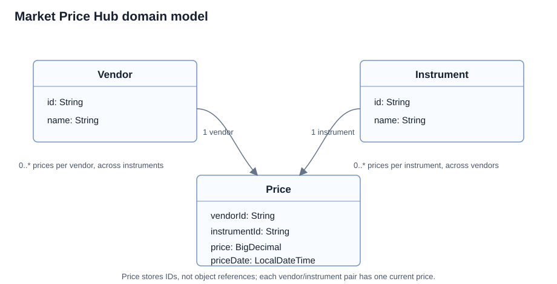
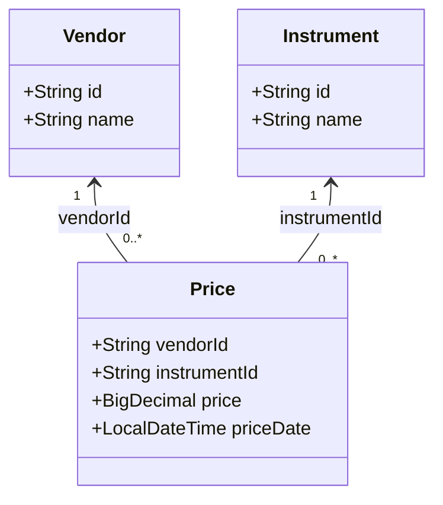
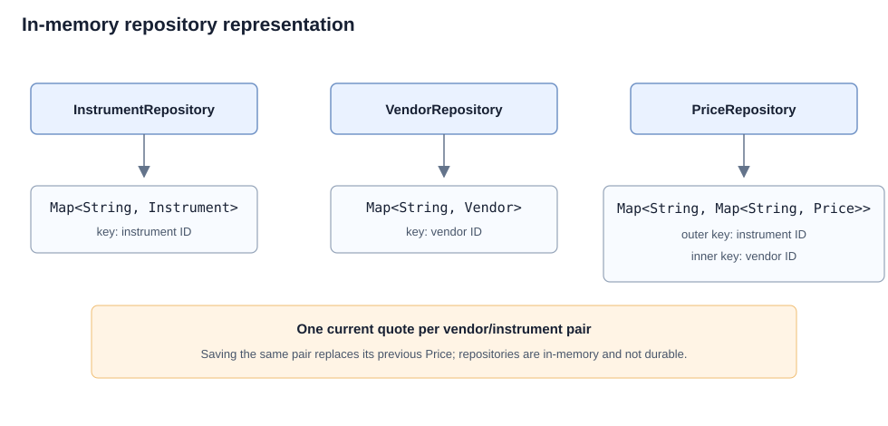
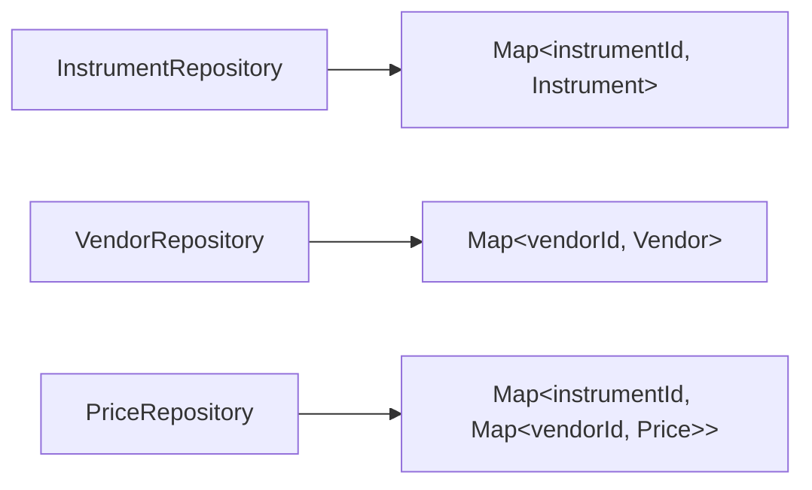

# Domain Model

## Scope and persistence

The domain consists of three immutable Java records: `Instrument`, `Vendor`, and `Price`. They are held by in-memory repositories; the application does not currently use a database or retain data across restarts. In this document, “stored” refers to the current repository contents in the running process, not durable persistence.

## Logical domain model

Mermaid class diagram source

`Price` associates a vendor with an instrument and records the quoted amount and its date/time. A vendor can quote prices for many instruments, and an instrument can have quotes from many vendors. The IDs in `Price` are scalar values, not object references; the repository does not load or embed a `Vendor` or `Instrument` inside a `Price`.

The associations above describe the intended domain relationship. When a price is published through the API, the service checks that both referenced IDs exist before saving it. The repositories themselves do not enforce foreign-key constraints, and the model records do not validate those references.

| Object | Fields | Meaning |
|---|---|---|
| `Instrument` | `id: String`, `name: String` | A market instrument identified by its ID. |
| `Vendor` | `id: String`, `name: String` | A price provider identified by its ID. |
| `Price` | `vendorId: String`, `instrumentId: String`, `price: BigDecimal`, `priceDate: LocalDateTime` | A vendor's price for an instrument at a given date/time. |

These are Java records, so their state is immutable after creation. API DTO validation places length, non-blank, positive-price, and numeric precision constraints on requests; those constraints are not intrinsic to the domain records.

## In-memory repository representation

Mermaid storage diagram source

The instrument and vendor repositories map each object's ID to its record. The price repository is indexed first by `instrumentId`, then by `vendorId`. Consequently, it stores at most one current price per vendor/instrument pair. Saving a later price for the same pair replaces the previous value; this model does not retain quote history.

The in-memory implementations use `ConcurrentHashMap`. Price repository operations are additionally synchronised. These choices support safe access to the shared in-process maps, but do not provide durable storage or shared state across application instances.

## Domain behaviour derived from the model

- **Best price:** the price repository selects the lowest numeric `BigDecimal` for an instrument. The model has no currency or unit field, so the values being compared must already be comparable.
- **Stale-price cleanup:** a price is eligible for deletion when `priceDate` is strictly before the configured cutoff. A price exactly at the cutoff is retained.
- **Read responses:** services join prices with their vendor or instrument records by ID. The list endpoints sort their output by the related ID so response order does not depend on map iteration.
