# Market Price Hub Design

## Overview

Market Price Hub provides REST endpoints for managing instruments, vendors, and market prices. The application uses a controller/service/repository design and stores data in in-memory repositories.

Requests pass through validation and Spring MVC controllers before being handled by application services. Services coordinate domain repositories, and repository implementations use concurrent in-memory maps.

The application requires an active Spring profile at startup. The `local` profile additionally loads demo data from `demo-data.csv`.

The sequence diagrams below are included as SVG images for viewers without Mermaid support. Expand each Mermaid source section to inspect or edit the source.

## Design choices and rationale

### Layered REST design

The application separates HTTP handling (controllers), business rules (services), and data access (repository interfaces and implementations). This keeps request parsing and response formatting out of the core operations, while services can be tested independently of Spring MVC. Repository interfaces also allow a different storage implementation to be introduced without changing controller or service responsibilities.

Request and response DTOs define the API boundary rather than exposing persistence details directly. Bean Validation rejects malformed request bodies early, and controllers validate query identifiers before invoking services. This gives clients clear HTTP errors and keeps basic input constraints close to the API contract.

### In-memory storage for the current scope

The repositories use concurrent in-memory maps, avoiding database setup and making the application straightforward to run as a self-contained service or demonstration. The repository interfaces keep that implementation replaceable.

This is a simplicity and portability trade-off, not durable storage: data is lost when the process stops, and separate application instances do not share state. A persistent repository would be needed for production data retention or horizontal scaling.

### One current price per vendor and instrument

Prices are indexed by instrument ID and then vendor ID. Saving another price for the same pair replaces the existing value, so the repository represents each vendor's current quote for each instrument rather than a historical series. This keeps price retrieval and best-price lookup simple for the current API.

The best-price operation returns the lowest numeric price among the stored quotes. The model does not include currency or unit conversion, so callers must only compare prices that are already comparable. Historical quote retention or cross-currency comparison would require additional domain data and behaviour.

### Deterministic read responses

The price-list endpoints sort their results by instrument or vendor ID before returning them. The all-prices endpoint sorts by vendor ID and then instrument ID. This avoids relying on map iteration order, producing stable responses that are easier for API clients to consume and for tests to verify.

### Configurable stale-price cleanup

Staleness is based on each quote's `priceDate`; the scheduled task computes a cutoff from the configured stale age, and the repository removes quotes strictly older than that cutoff. Keeping the cron schedule and age in application properties lets deployments adjust cleanup behaviour without changing business logic.

### Profile-specific demo data

Demo data is loaded from a CSV only under the `local` profile, keeping sample records out of other profiles. The concurrent demo workload is also restricted to `local` and runs by default when using the provided Windows launcher, which sets the `-Ddemo.activity.enabled=true` JVM system property. Removing that property disables the workload while leaving data seeding enabled. Requiring an explicit active profile also prevents the application from starting with an accidental or ambiguous configuration.

## Publish a price

`POST /marketpricehub/publishPrices`

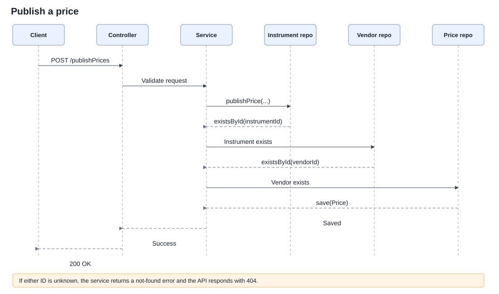

Mermaid source

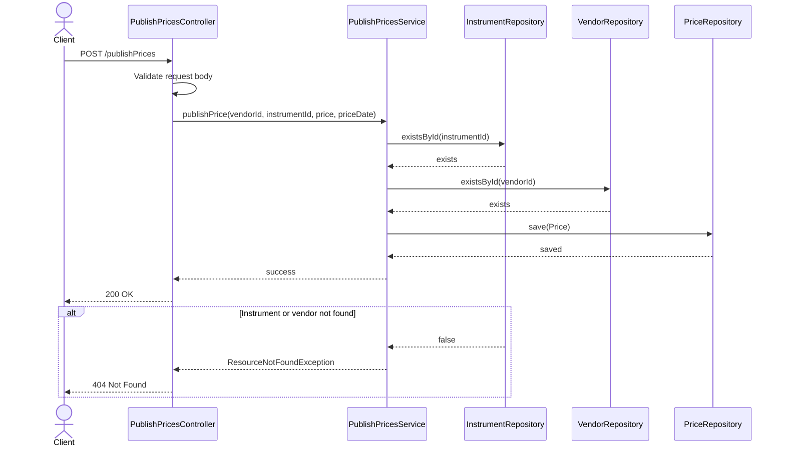

## Add an instrument

`POST /marketpricehub/addInstrument`

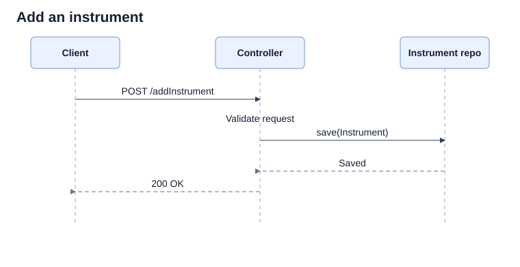

Mermaid source

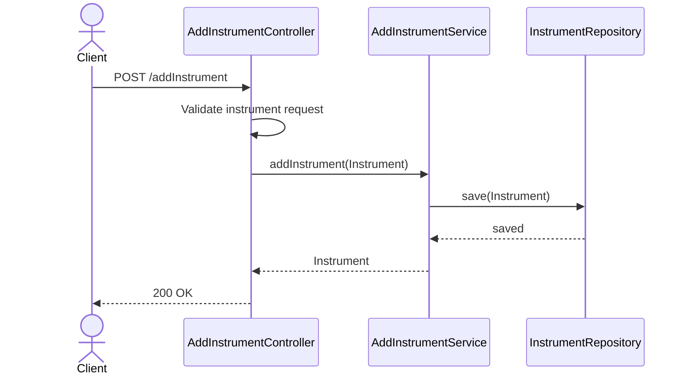

## Add a vendor

`POST /marketpricehub/addVendor`

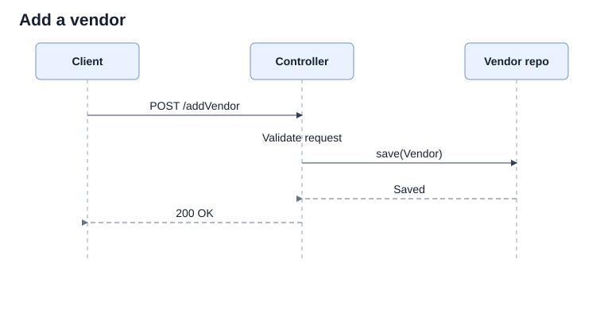

Mermaid source

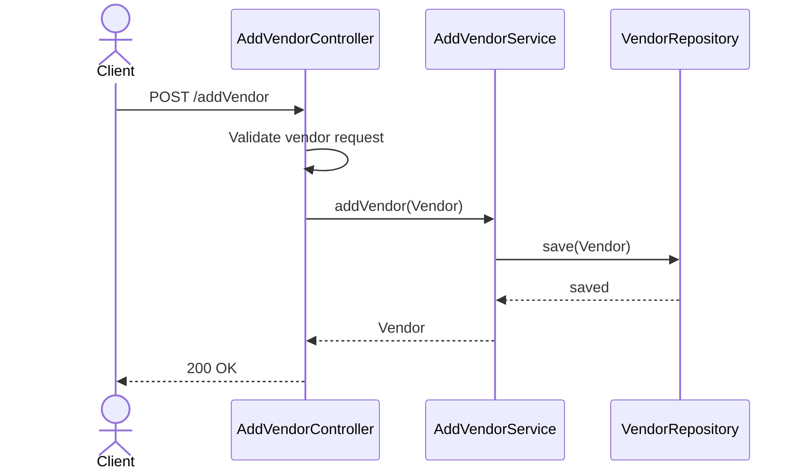

## Retrieve prices for an instrument

`GET /marketpricehub/getPricesForAllVendorsOfGivenInstrument`

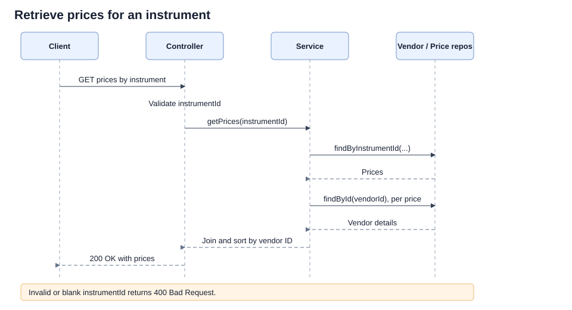

Mermaid source

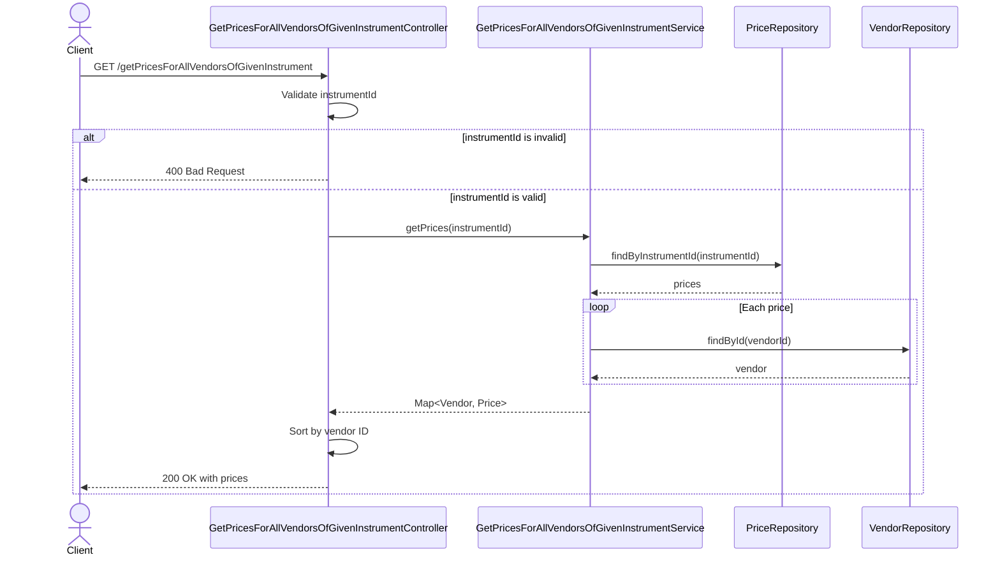

## Retrieve the best price for an instrument

`GET /marketpricehub/getBestPriceForAllVendorsOfGivenInstrument`

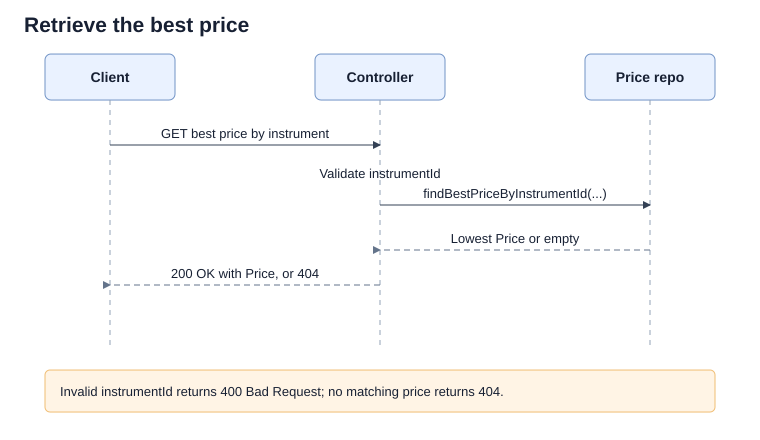

Mermaid source

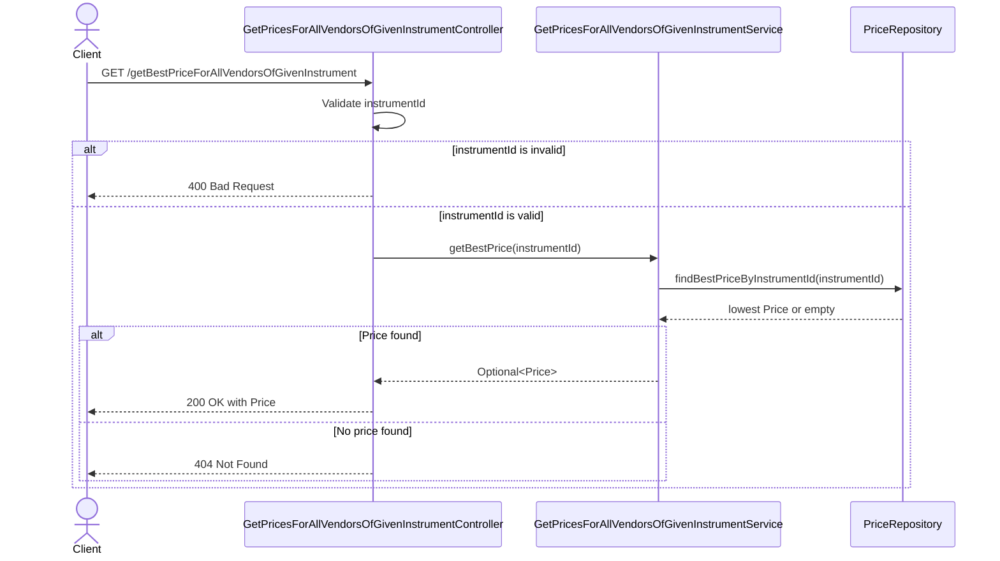

## Retrieve prices for a vendor

`GET /marketpricehub/getPricesForAllInstrumentsOfGivenVendor`

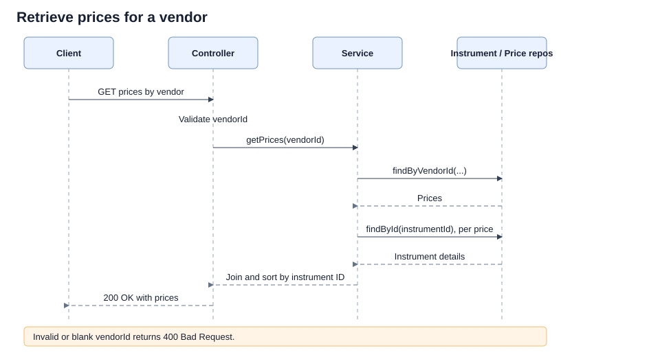

Mermaid source

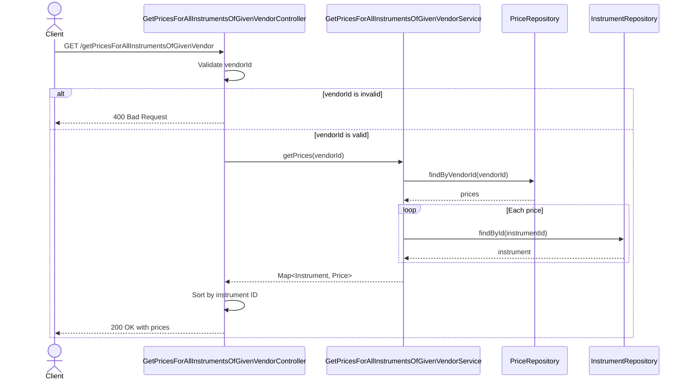

## Retrieve all prices

`GET /marketpricehub/getAllPrices`

Returns every currently stored price, including its vendor and instrument IDs and descriptions, price, and price date. Results are ordered by vendor ID and then instrument ID. This endpoint is useful for inspecting the complete current in-memory price set, for example during testing.

Mermaid source

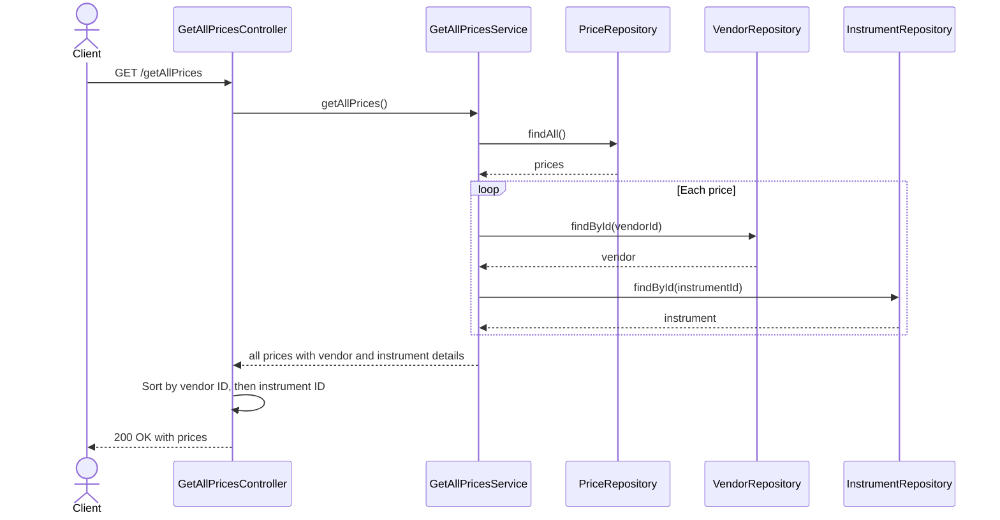

## Scheduled stale-price deletion

Stale prices are removed by a scheduled task. The schedule and stale period are configured in `application.properties`.

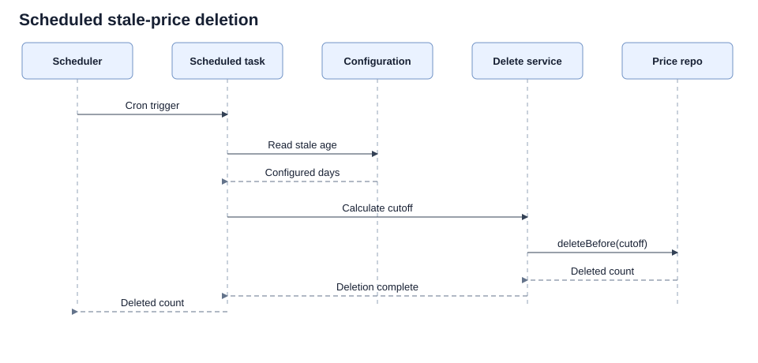

Mermaid source

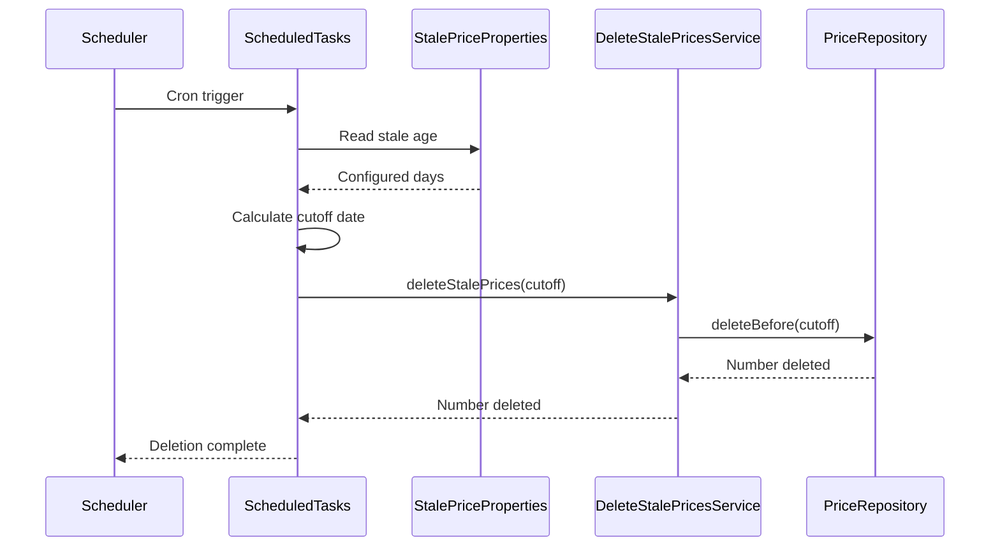

## Local profile startup and demo activity

The demo data is loaded only when the application runs with the `local` profile. The concurrent demo activity starts after loading when the `demo.activity.enabled` JVM system property is `true`; the provided Windows launcher enables it.

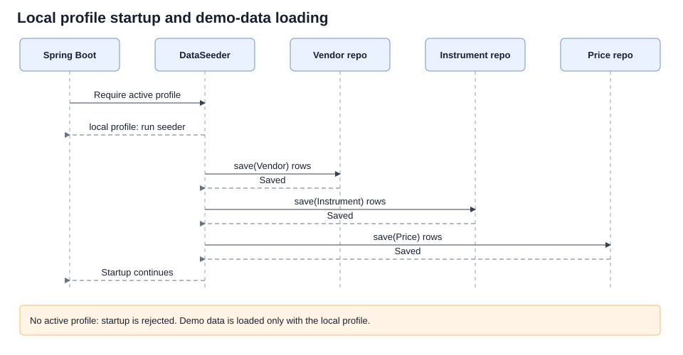

Mermaid source

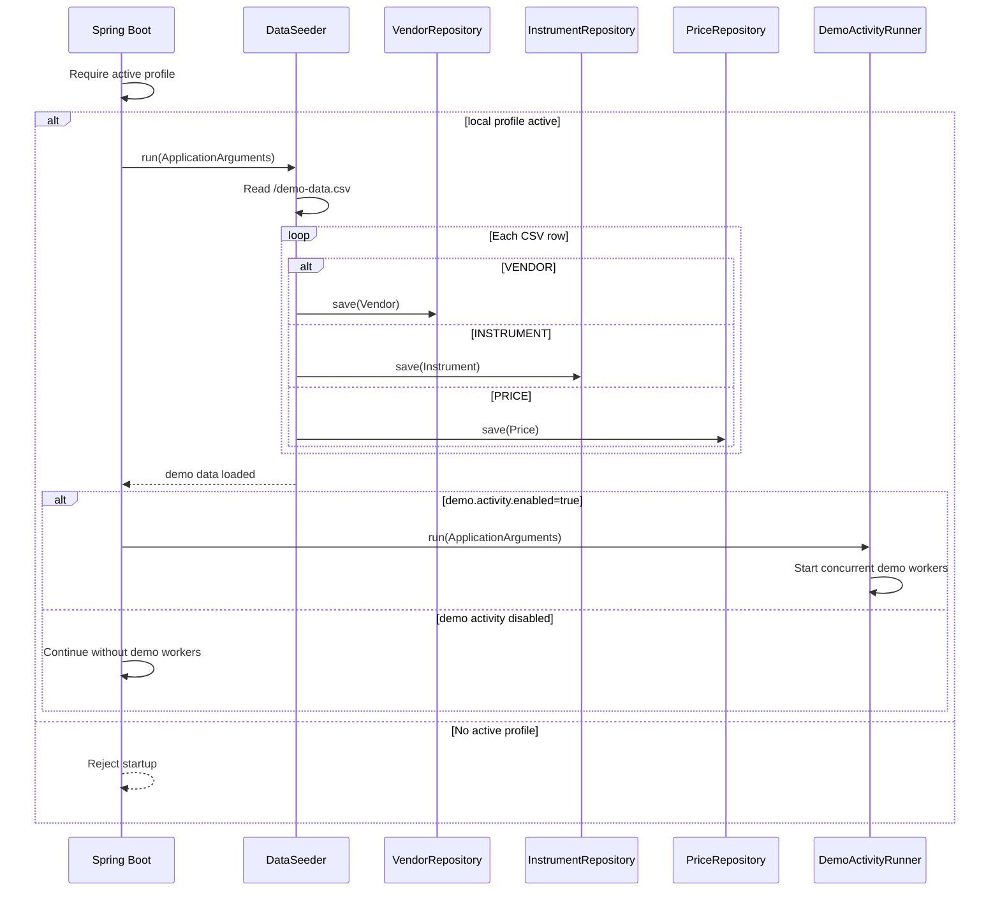

